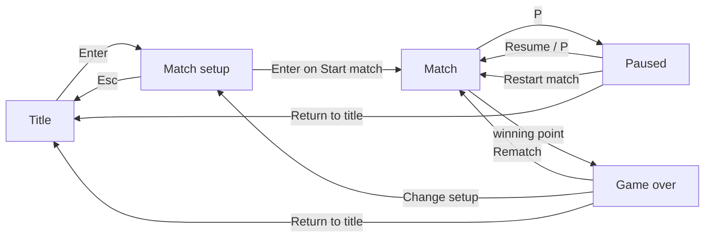

# Pongo

Pongo is classic arcade Pong in your terminal. You can play a friend on the same keyboard or play the computer on
Easy, Normal, or Hard. It's written in Go with [Bubble Tea](https://github.com/charmbracelet/bubbletea).

**Status:** v1.0.0, the complete game: match setup, local two-player and single-player matches, pausing, restarts,
rematches, and terminal resizing. Pongo creates no config, cache, save, or log files.

## Install

Pongo runs on Linux and macOS, on `amd64` and `arm64`. Pick one of the three ways below.

### Prebuilt binary

Every [GitHub Release](https://github.com/calvertjadon/pongo/releases) has one archive per platform, named
`pongo_<version>_<os>_<arch>.tar.gz`, plus a `SHA256SUMS` file. Each archive contains the `pongo` executable and the
MIT `LICENSE`.

```sh
VERSION=v1.0.0
OS=linux     # or darwin
ARCH=amd64   # or arm64
ARCHIVE="pongo_${VERSION}_${OS}_${ARCH}.tar.gz"
BASE="https://github.com/calvertjadon/pongo/releases/download/${VERSION}"

curl -fLO "${BASE}/${ARCHIVE}"
curl -fLO "${BASE}/SHA256SUMS"

# Check the download. On Linux:
grep " ${ARCHIVE}\$" SHA256SUMS | sha256sum --check
# On macOS:
grep " ${ARCHIVE}\$" SHA256SUMS | shasum -a 256 --check

tar -xzf "${ARCHIVE}"
mkdir -p ~/.local/bin
install -m 0755 pongo ~/.local/bin/pongo
```

Put `~/.local/bin` on your `PATH`, or install to another directory that's already on it, such as `/usr/local/bin`.

The binaries aren't signed or notarized. If you download a macOS archive with a browser instead of `curl`, macOS may
refuse to open `pongo`. Clear the quarantine flag with `xattr -d com.apple.quarantine pongo`.

### `go install`

You need Go 1.27.0 or later:

```sh
go install github.com/calvertjadon/pongo@latest   # or @v1.0.0
```

Go puts the binary in `$(go env GOBIN)` or, if that's empty, in `$(go env GOPATH)/bin`. That directory must be on your
`PATH`. See [Troubleshooting](#troubleshooting).

### From source

You need Go 1.27.0 or later and Git:

```sh
git clone https://github.com/calvertjadon/pongo.git
cd pongo
go build -o pongo .
./pongo
```

`--version` reports the commit's tag in a clean, tagged checkout. Any other checkout reports a Go pseudo-version, with
`+dirty` added if there are uncommitted changes.

## Terminal requirements

- An interactive terminal on Linux or macOS. Standard input and standard output must both be a TTY, so you can't pipe
  the game or redirect its output.
- A terminal of at least **80 columns by 28 rows**.
- ANSI escape sequences and an alternate screen. Pongo draws in the alternate screen and leaves your scrollback alone.
- Resize notifications through `SIGWINCH`.
- No color support needed. Pongo draws everything in ASCII and shows all state with text and markers. It works on
  monochrome terminals and with `NO_COLOR` set.

Ubuntu's default terminal and macOS Terminal.app both meet these requirements. Windows isn't supported.

## Playing

Run `pongo`.

### Game flow



1. **Title.** `Enter` opens match setup and `Q` quits.
2. **Match setup.** Choose these settings:
   - **Mode:** Single player (against the computer) or Local two-player.
   - **Winning score:** 5, 7, or 11.
   - **Computer difficulty:** Easy, Normal, or Hard. In Local two-player it shows `--` and the cursor skips it.

   The defaults are Single player, 7, and Normal. `>` marks the selected row and `< >` brackets a value you can
   change. `Esc` goes back to the title and keeps your edits. Setup remembers your choices until you quit.
3. **Match.** The court is 70 by 20 cells. The score sits above it, and the winning score and mode sit below the
   score. Before every serve, a 0.8-second countdown runs, and you can move your paddle during it. A point goes to a
   player when the ball passes the other player's paddle. The player who conceded receives the next serve.
4. **Game over.** The first player to reach the winning score wins, with no two-point margin. The overlay shows the
   winner and the final score.

### Controls

| Screen | Key | Action |
|---|---|---|
| Title | `Enter` | Open match setup |
| Title | `Q` | Quit |
| Match setup | `Up` / `Down` | Move between rows (wraps around) |
| Match setup | `Left` / `Right` | Change the selected value (wraps around) |
| Match setup | `Enter` | Accept and move to the next row; on **Start match**, start the match |
| Match setup | `Esc` | Back to the title, keeping your edits |
| Match, single player | `W` / `S` or `Up` / `Down` | Move your paddle (left side) |
| Match, two-player | `W` / `S` | Move Player 1's paddle (left side) |
| Match, two-player | `Up` / `Down` | Move Player 2's paddle (right side) |
| Match | `P` | Pause |
| Paused | `Up` / `Down` | Choose **Resume**, **Restart match**, or **Return to title** |
| Paused | `Enter` | Do the selected action |
| Paused | `P` | Resume, whichever row is selected |
| Game over | `Up` / `Down` | Choose **Rematch**, **Change setup**, or **Return to title** |
| Game over | `Enter` | Do the selected action |
| Any screen | `Ctrl+C` | Quit immediately |

Each key press or key repeat moves a paddle two rows. Hold a key to keep moving. In single player, the computer plays
the right paddle.

`Q` quits only from the title or the terminal-too-small notice, so you can't quit a match or setup by accident. To
leave a match, pause and choose **Return to title**, or press `Ctrl+C`.

### What the menu actions do

- **Resume** continues the frozen rally after a fresh 0.8-second countdown. Pausing never changes the ball's position
  or speed.
- **Restart match** starts the current match over from 0–0 with the same settings.
- **Rematch** plays again with the same settings and switches which side gets the opening serve.
- **Change setup** opens match setup with the finished match's settings filled in.
- **Return to title** ends the match. Setup keeps your last settings.

### Resizing

If the terminal shrinks below 80 by 28, Pongo freezes the game and shows the current size and the required size.
Make the terminal bigger and play continues exactly where it stopped, with no extra countdown. `Q` and `Ctrl+C` still
work while the notice is up. Above the minimum size, resizing only re-centers the layout.

## Command line

```text
pongo             Play the game. Requires an interactive terminal.
pongo --help      Print usage and exit. Works without a terminal.
pongo --version   Print the version and exit. Works without a terminal.
```

Pongo accepts no other arguments. Every exit path below restores the cursor, the input mode, and your normal screen.

| How Pongo exits | Status |
|---|---:|
| `--help` or `--version` | 0 |
| `Q` in the game | 0 |
| Unsupported argument | 2 |
| No terminal, other startup or runtime error, or recovered panic | 1 |
| `Ctrl+C` or `SIGINT` | 130 |
| `SIGHUP`, such as closing the terminal window | 129 |
| `SIGTERM` | 143 |

Errors print to standard error, prefixed with `pongo:`.

## Troubleshooting

### `pongo: an interactive terminal is required`

Standard input or standard output isn't a terminal. That happens when the game is piped (`pongo | less`), redirected
(`pongo > out.txt`), run from a non-interactive script, or run over SSH without a TTY. Run `pongo` directly in a
terminal window. Over SSH, force a TTY with `ssh -t host pongo`.

### The screen says to resize the terminal

The terminal is smaller than 80 by 28. Enlarge the window, reduce the font size, or zoom out until the notice goes
away. The notice shows the current size. In tmux or screen, a split pane counts as the terminal, so make the pane big
enough or zoom it (`prefix` `z` in tmux).

### `pongo: command not found` after `go install`

Go installed the binary into a directory that isn't on your `PATH`. Find that directory:

```sh
go env GOBIN    # if this prints nothing, use the next line
echo "$(go env GOPATH)/bin"
```

Add it to your `PATH` in your shell profile, such as `~/.bashrc`, `~/.zshrc`, or `~/.profile`:

```sh
export PATH="$PATH:$(go env GOPATH)/bin"
```

Then open a new shell or `source` the profile. Running the full path, such as `"$(go env GOPATH)/bin/pongo"`, also
works.

### The terminal looks broken after Pongo exits

Pongo restores the terminal on every exit it can catch. `SIGKILL` (`kill -9`) and power loss can't be caught. If your
shell is left without echo or a visible cursor, type `reset` and press `Enter`, even though you won't see what you
type.

## Contributing

You need Go 1.27.0 or later and [golangci-lint](https://golangci-lint.run/) v2.13.2:

```sh
go install github.com/golangci/golangci-lint/v2/cmd/golangci-lint@v2.13.2
```

[`CODING_STANDARDS.md`](CODING_STANDARDS.md) covers the architecture, testing, and review rules. Every change must pass
this gate from the repository root. CI runs it on Linux and macOS:

```sh
golangci-lint fmt --diff --config=.golangci.yml
go mod tidy -diff
go vet ./...
golangci-lint run --config=.golangci.yml ./...
go test -race -cover ./...
go build ./...
```

Every command must exit with status 0, and the formatter must print no diff.

CI runs the gate on Go 1.27.0. If golangci-lint fails with `export data version` typecheck errors under a newer Go
patch release, run the gate with `GOTOOLCHAIN=go1.27.0` exported, and reinstall golangci-lint under that toolchain.

### Releases

Pushing a `vMAJOR.MINOR.PATCH` tag runs [`.github/workflows/release.yml`](.github/workflows/release.yml). The
workflow does the following:

1. Runs the gate.
2. Builds `linux` and `darwin` on `amd64` and `arm64` with the latest Go 1.27 patch release.
3. Checks each archive on a matching runner: contents, checksum, exact `--version`, `--help`, bad arguments, rejection
   without a terminal, pseudo-terminal startup, and terminal restoration after `Q` and signals.
4. Publishes the GitHub Release.

To run the same per-archive check yourself, download an archive and `SHA256SUMS` for your own platform and run:

```sh
PONGO_RELEASE_ARCHIVE="$PWD/pongo_v1.0.0_linux_amd64.tar.gz" \
PONGO_RELEASE_SUMS="$PWD/SHA256SUMS" \
PONGO_RELEASE_VERSION=v1.0.0 \
go test -run '^TestReleaseArchive$' -v .
```

Without `PONGO_RELEASE_ARCHIVE`, the test skips.

## License

[MIT](LICENSE)
